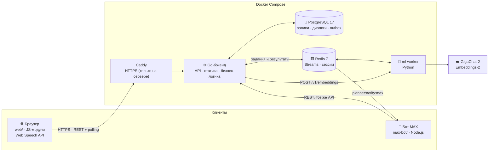
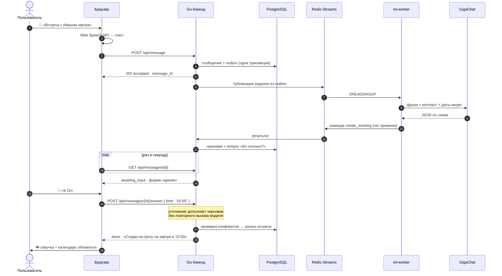
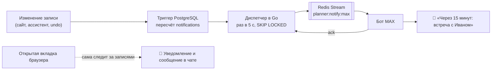

# Жучка — голосовой ассистент задач и встреч

Жучка — личный планировщик, которым управляют голосом или текстом на русском. Пользователь говорит «Напомни завтра в 10 позвонить Ивану» или «Поставь встречу с дизайнером в четверг в 11», а ассистент создаёт запись, переспрашивает недостающее, находит записи по смыслу, предупреждает о пересечениях встреч и вовремя напоминает: в браузере и в мессенджере MAX.

**Демо:** https://51-250-90-230.sslip.io (тестовые аккаунты указаны [ниже](#вход)).

<p align="center"><i>Голос → GigaChat разбирает фразу → Go проверяет и сохраняет → календарь обновляется</i></p>

## Содержание

- [Что умеет](#что-умеет)
- [Запуск](#запуск)
- [Архитектура](#архитектура)
- [Технологии](#технологии)
- [Структура репозитория](#структура-репозитория)
- [Принятые решения](#принятые-решения)
- [Что улучшить при наличии времени](#что-улучшить-при-наличии-времени)
- [Если не работает](#если-не-работает)
- [Документация](#документация)

## Что умеет

| ID | Возможность | Приоритет | Статус |
|---|---|:---:|:---:|
| FR-1 | Создание задачи и напоминания | Must | ✅ |
| FR-2 | Создание встречи | Must | ✅ |
| FR-3 | Список записей за период | Must | ✅ |
| FR-4 | Поиск записей, в том числе по смыслу (embeddings) | Must | ✅ |
| FR-5 | Ввод голосом и текстом, текстовый ответ | Must | ✅ |
| FR-6 | Хранение данных между запросами и сессиями | Must | ✅ |
| FR-7 | Относительные даты и уточняющие вопросы | Must | ✅ |
| FR-8 | Озвучка ответа | Should | ✅ |
| FR-9 | Изменение, удаление, отметка «выполнено» — голосом и вручную | Should | ✅ |
| FR-10 | Контекст диалога («перенеси её на завтра») | Should | ✅ |
| FR-11 | Конфликты встреч | Should | ✅ |
| FR-12 | Несколько пользователей | Should | ✅ |
| FR-13 | Срабатывание напоминаний: в чате, уведомлениями браузера и в MAX | Should | ✅ |
| FR-14 | Повторяющиеся задачи и встречи | Could | — |
| FR-15 | Отмена последнего действия | Could | ✅ |
| FR-16 | Интеграция с внешним календарём | Could | — |

Сверх требований:

- **Бот MAX.** Уведомления за 15 минут и в момент начала, утренняя сводка, тихие часы и создание записей кнопками ([max-bot](max-bot/README.md)).
- **Ручное управление.** Календарь на неделю и месяц, создание и редактирование записей в форме, полноэкранный режим.
- **Настройки ассистента.** Имя и мужской или женский голос озвучки.

Примеры фраз:

> «Напомни завтра в 10 утра позвонить Ивану»
> «Поставь встречу с Иваном завтра» — ассистент спросит время
> «Что у меня на этой неделе?»
> «Найди задачу про билеты»
> «Перенеси её на пятницу» · «Отмени последнее»

## Запуск

### Требования

- Docker с Compose v2 (Docker Desktop на Windows и macOS).
- Ключ GigaChat: `Authorization Key` из личного кабинета [developers.sber.ru](https://developers.sber.ru/studio). Без ключа можно запустить [заглушку ML](#без-ключа-gigachat).
- Для голоса нужен Chrome, Edge или Safari.

### Быстрый старт

```bash
cp .env.example .env            # Windows PowerShell: Copy-Item .env.example .env
# В .env задайте GIGACHAT_AUTH_KEY и GIGACHAT_SCOPE, подходящий к ключу
docker compose -f compose.yaml up -d --build --wait
```

Откройте **http://localhost:8080**.

> `-f compose.yaml` нужен для локального запуска. Без него Compose подхватит `compose.override.yaml` с Caddy для HTTPS на сервере, а Caddy займёт порты 80 и 443. Чтобы не писать флаг каждый раз, добавьте в `.env` строку `COMPOSE_FILE=compose.yaml`.

Миграции применяются автоматически при старте. Данные PostgreSQL и Redis хранятся в Docker volumes и переживают перезапуск.

| Сервис | Адрес | Назначение |
|---|---|---|
| `backend` | http://localhost:8080 | Сайт и API |
| `postgres` | localhost:55432 | База данных |
| `redis` | localhost:6379 | Очереди и сессии |
| `ml-worker` | только внутри сети Docker | Разбор фраз, embeddings |

Порты меняются через `APP_PORT`, `POSTGRES_PORT` и `REDIS_PORT` в `.env`.

### Вход

Тестовые аккаунты создаёт миграция. На странице входа две кнопки подставляют их данные.

| Логин | Пароль |
|---|---|
| `demo1` | `DemoPass1!` |
| `demo2` | `DemoPass2!` |

У каждого пользователя свои записи и свои диалоги.

### Без ключа GigaChat

[ml-stub](ml-stub/README.md) разбирает фразы правилами вместо модели и подходит для проверки сценариев из ФТ:

```bash
docker compose -f compose.yaml up -d --build --wait backend postgres redis
cd ml-stub && docker compose up -d
```

Не запускайте `ml-stub` вместе с `ml-worker`: оба читают одну очередь и делят сообщения между собой.

Интерфейс можно открыть и вообще без бэкенда, на встроенной заглушке API: см. [web/README.md](web/README.md#без-бэкенда).

### Бот MAX (необязательно)

```bash
# в корневом .env: BOT_SERVICE_TOKEN (≥ 32 символов) и MAX_BOT_URL
# в max-bot/.env: MAX_BOT_TOKEN и тот же BOT_SERVICE_TOKEN
cd max-bot && docker compose up -d
```

После этого на сайте: меню профиля → «Подключить MAX». Подробности и проверка без настоящего MAX описаны в [max-bot/README.md](max-bot/README.md).

### Обновление после правок

```bash
docker compose -f compose.yaml up -d --build backend     # Go или web/
docker compose -f compose.yaml up -d --build ml-worker   # Python
docker compose -f compose.yaml logs -f backend
```

Файлы `web/` попадают в образ бэкенда при сборке, поэтому после пересборки обновите страницу с Ctrl+Shift+R.

### Тесты

```bash
cd backend && go test ./...                 # с TEST_DATABASE_URL и TEST_REDIS_URL — вместе с интеграционными
cd ml-worker && python -m unittest -v       # без ключа и сети
cd max-bot && node --test
cd ml-stub && node --test                   # сценарии приёмки из ФТ
```

## Архитектура

### Компоненты



| Компонент | Отвечает за | Не делает |
|---|---|---|
| **Браузер** | Распознавание и синтез речи, чат, календарь, напоминания и уведомления открытой вкладки | Не хранит данных, кроме сессии и настроек |
| **Go-бэкенд** | Авторизация, проверка команд, конфликты, транзакции, undo, расписание уведомлений, раздача статики | Не разбирает естественный язык |
| **ml-worker** | Текст → структурированная команда (JSON Schema), векторы для смыслового поиска | Не видит БД, токены и `user_id`, не выполняет операции |
| **PostgreSQL** | Единственный источник истины: записи, пользователи, диалоги, outbox, уведомления | — |
| **Redis** | Очереди ML и уведомлений (Streams), сессии входа, ограничение попыток входа | Не хранит бизнес-данных |
| **Бот MAX** | Доставка уведомлений и сводки, второй клиент ассистента | Не считает расписание |

Главный принцип: **модель только понимает, решает Go.** LLM переводит фразу в команду вида `{ action: "create", type: "meeting", params: {...} }`. Права, обязательные поля, даты, конфликты и запись в БД проверяет детерминированный код в одной транзакции.

### Путь голосового запроса



Почему так:

- **Outbox и Redis Streams.** Сообщение не теряется, если бэкенд или воркер упали между шагами. Повторная доставка безопасна: идемпотентность обеспечивают `client_message_id` и `attempt_id` в БД.
- **202 и polling** вместо долгого HTTP-запроса. Ответ модели не зависит от открытого соединения, а после перезагрузки страницы диалог продолжается с того же места.
- **Уточнения полями формы** (`date`, `time`, `confirmed`), а не новым текстом. Ответ «в 15» не уходит в модель повторно: это быстрее, дешевле и предсказуемее.

### Уведомления



Расписание считает бэкенд, поэтому любое изменение записи (перенос, отмена, undo) сразу пересчитывает уведомления. Неподтверждённая доставка через 5 минут уходит повторно. Тихие часы и утренняя сводка учитывают часовой пояс пользователя.

## Технологии

| Слой | Выбор | Почему |
|---|---|---|
| Бэкенд | **Go 1.26**, chi v5, `database/sql` + pgx v5, goose | Строгая типизация, простой деплой одним бинарником, явный SQL и транзакции без ORM |
| База | **PostgreSQL 17** | Транзакции, `CHECK`-ограничения, частичные индексы, `FOR UPDATE SKIP LOCKED`, триггеры |
| Очереди и сессии | **Redis 7** Streams | Consumer groups, `XAUTOCLAIM` после сбоев, TTL для сессий, без отдельного брокера |
| NLU | **GigaChat-2** со structured output (JSON Schema) | Хорошо понимает русский, данные остаются в РФ, ответ по строгой схеме |
| Смысловой поиск | **Embeddings-2** + словесные совпадения | «Презентация» находит «слайды»; при сбое остаётся обычный поиск |
| ML-воркер | **Python 3.12**, только `redis` и стандартная библиотека | Минимум зависимостей, легко заменить провайдера модели |
| Фронтенд | **Vanilla JS** (ES-модули), HTML, CSS | Без сборки и npm: открыл файл — правишь. Отдаётся тем же Go-сервером |
| Голос | **Web Speech API** и `speechSynthesis` | Бесплатно, без задержки сети и без передачи аудио на сервер |
| Мессенджер | **MAX Bot API**, Node.js 22 | Уведомления на телефон без мобильного приложения |
| Инфраструктура | Docker Compose, Caddy | Запуск одной командой; HTTPS с автосертификатом на сервере |

## Структура репозитория

```text
backend/        Go: API, бизнес-логика, миграции, раздача web/       → backend/README.md
  docs/         контракты HTTP/Redis, диалоги, авторизация, undo, ФТ
web/            фронтенд: чат, календарь, голос, заглушка API         → web/README.md
ml-worker/      GigaChat + Embeddings-2, обработчик Redis Streams     → ml-worker/README.md
ml-stub/        замена ml-worker на правилах для проверки без ключа   → ml-stub/README.md
max-bot/        бот MAX: уведомления, сводка, создание кнопками       → max-bot/README.md
compose.yaml            приложение, ML, PostgreSQL, Redis
compose.override.yaml   Caddy для HTTPS на сервере
Caddyfile               домен и проксирование на backend:8080
.env.example            настройки запуска
```

## Принятые решения

Требования оставили на усмотрение разработчиков стек, LLM, STT/TTS и БД, а также часть поведения. Вот что решили сами.

**Архитектура**

- **LLM как парсер, а не исполнитель.** Модель возвращает команду по JSON Schema, а всё, что меняет данные, делает Go. Так модель не может удалить чужую запись, придумать время встречи или обойти проверку конфликтов.
- **Даты считает код, а не модель.** Go передаёт в промпт готовые якоря: `today`, `tomorrow`, «ближайший четверг», «четверг следующей недели». LLM часто ошибается в арифметике дней недели, а так «в следующий четверг» всегда понимается одинаково.
- **Асинхронная обработка через outbox и Redis Streams** вместо синхронного вызова модели в HTTP-обработчике: устойчивость к падениям и повторам, ответ доступен после перезагрузки страницы.
- **Один активный сценарий на диалог.** Пока ассистент ждёт уточнения, новое сообщение отклоняется (`409 conversation_busy`), и ответы не перемешиваются.
- **Гибридный поиск.** Векторы сочетаются с совпадением слов. Embeddings не обязательны: при ошибке поиск продолжает работать по словам.

**Продукт**

- **Распознавание речи в браузере.** Web Speech API не требует ключей и сервера, а пользователь сразу видит распознанный текст. Цена — голос недоступен в Firefox.
- **Контекст через `focus`.** Последняя созданная или показанная запись запоминается, поэтому «перенеси её на завтра» и «отмени встречу» относятся к ней. Если записей несколько, ассистент показывает варианты, а не выбирает наугад.
- **Отмена любого действия.** Мягкое удаление и `undo_token` в каждом ответе: кнопка «Отменить» возвращает запись с тем же id.
- **Уведомления в MAX вместо push.** Push на телефон в ФТ вне рамок, но без него напоминание бесполезно при закрытой вкладке. Мессенджер решает эту задачу без мобильного приложения.
- **Ручное управление рядом с голосом.** Календарь, форма записи и двойной клик для правки. Голос удобен для создания, а глазами и мышью быстрее просматривать и поправлять.
- **Заглушки для параллельной работы.** `web/js/mock` и `ml-stub` позволили делать фронтенд и проверять сценарии ФТ до готовности бэкенда и без ключа модели.

## Что улучшить при наличии времени

| Направление | Что сделать |
|---|---|
| **Повторы (FR-14)** | Правило повтора в формате RRULE, развёртка в календаре, «каждый понедельник в 10» |
| **Связанные напоминания** | «Напомни про встречу в 15» → встреча и напоминание к ней за 15 минут, как в ФТ. Сейчас бэкенд отвечает, что связанные напоминания не поддерживаются |
| **Внешние календари (FR-16)** | Синхронизация с Google Calendar и Яндекс Календарём через CalDAV, экспорт `.ics` |
| **Голос везде** | Серверное распознавание (SaluteSpeech, Whisper) как запасной путь для Firefox и мобильных браузеров |
| **Realtime** | SSE или WebSocket вместо polling; Web Push, чтобы уведомления приходили и с закрытой вкладкой |
| **Поиск** | pgvector и фоновая индексация вместо расчёта векторов на каждый запрос |
| **Профиль** | Регистрация, восстановление пароля, часовой пояс, имя и голос ассистента на сервере, а не в браузере |
| **MAX** | Webhook вместо long polling, пояс пользователя в мастерах бота |
| **Качество** | E2E-тесты интерфейса (Playwright), набор фраз для регрессии промптов, CI с линтерами |
| **Эксплуатация** | Метрики (Prometheus), трассировка пути сообщения, алерты на ошибки модели, бэкапы БД |
| **Мобильность** | PWA: установка на телефон, офлайн-просмотр записей |

## Если не работает

- **Порты 80/443 заняты или запустился Caddy.** Запускайте с `-f compose.yaml` или задайте `COMPOSE_FILE=compose.yaml` в `.env`.
- **Чат отвечает ошибкой.** Проверьте `GIGACHAT_AUTH_KEY` и `GIGACHAT_SCOPE`, затем `docker compose logs ml-worker`. OAuth `HTTP 400` обычно означает, что scope не подходит к ключу.
- **Чат отвечает дважды или через раз.** Одновременно запущены `ml-worker` и `ml-stub`. Остановите заглушку: `cd ml-stub && docker compose down`.
- **`declared as external, but could not be found` при запуске ml-stub.** Сначала поднимите приложение в корне.
- **Сборка падает на `go mod download` или `apk add` с таймаутом DNS.** Контейнеры сборки не видят интернет, часто из-за VPN с пересекающейся подсетью Docker. Создайте `compose.local.yaml` (в git он не нужен) и добавьте в `.env` строку `COMPOSE_FILE=compose.yaml:compose.local.yaml`:

  ```yaml
  services:
    backend:
      build:
        network: host
    ml-worker:
      build:
        network: host
  ```

- **Порт занят** (8080, 55432, 6379). Измените `APP_PORT`, `POSTGRES_PORT` или `REDIS_PORT` в `.env`.
- **Нет микрофона.** Нужны Chrome, Edge или Safari и адрес `localhost` или https. По IP-адресу через http доступен только текстовый ввод.
- **Изменили `web/`, а страница старая.** Пересоберите бэкенд: `docker compose -f compose.yaml up -d --build backend`, затем Ctrl+Shift+R.
- **Снова просит войти.** Сессия истекла или отозвана. Диагностика — в [README бэкенда](backend/README.md#диагностика).

## Документация

| Документ | О чём |
|---|---|
| [backend/README.md](backend/README.md) | Архитектура Go, БД, Redis, конфигурация, тесты |
| [web/README.md](web/README.md) | Интерфейс, режимы API, заглушка |
| [ml-worker/README.md](ml-worker/README.md) | Промпты, контекст, расход токенов, embeddings |
| [max-bot/README.md](max-bot/README.md) | Бот, уведомления, привязка аккаунта |
| [ml-stub/README.md](ml-stub/README.md) | Проверка без ключа GigaChat |
| [backend/docs/](backend/docs/) | Контракты: [HTTP и Redis](backend/docs/async-contract.md), [уточнения](backend/docs/dialogue-flow.md), [авторизация](backend/docs/auth.md), [выбор записи](backend/docs/selection.md), [конфликты](backend/docs/meeting-conflicts.md), [undo](backend/docs/reset-and-undo.md), [модель](backend/docs/model-integration.md), [HTTPS](backend/docs/https.md) |
