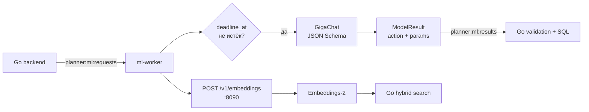

# ML worker

Техническая документация ML-части голосового планировщика. Воркер получает
**текст**, уже распознанный вне сервиса, читает задания из Redis Streams,
вызывает GigaChat и возвращает строго структурированную команду. Он не видит
Bearer-токен, `user_id`, аудио или PostgreSQL.

Go-бэкенд остаётся источником истины: проверяет права, поля, конфликты и
сохраняет изменения в транзакции. Модель не пишет SQL и не выполняет операции
сама.

## Состав

```text
worker.py                    Redis consumer и HTTP embeddings endpoint
adapter.py                   intent, create/list/search/mutation adapter
embeddings.py                клиент Embeddings-2, проверка и L2-нормализация
planner_model/parser.py      OAuth, GigaChat JSON Schema, parsing
planner_model/contract.py    контракт create/list/search
planner_model/gigachat_contract.py
                             prompts и нормализация дат/метаданных
planner_model/gigachat_credentials.py
                             чтение Authorization Key и scope из XLSX
test_adapter.py              unit-тесты без внешнего API
```

Используется Python 3.12, `redis==5.2.1` и стандартная библиотека для HTTP,
SSL и JSON.

## Архитектура



1. Go сохраняет сообщение и outbox в PostgreSQL, затем публикует job в
   `planner:ml:requests`.
2. Consumer group `planner-ml` читает job. Просроченная job не выполняется.
3. Адаптер вызывает модель и преобразует её JSON в backend-контракт.
4. Результат кэшируется на час по `attempt_id`, публикуется в
   `planner:ml:results`, исходная запись подтверждается через `XACK` и
   удаляется из потока.
5. После рестарта `XAUTOCLAIM` забирает pending-записи, простаивающие свыше
   120 секунд.

Идемпотентность, проверка `attempt_id` и применение результата — обязанность
Go. Воркер может безопасно повторно получить одну и ту же job.

## Контекст команды

Из backend приходит `ModelRequest`:

- `text`, `now`, `timezone`;
- `anchors` — календарные даты, рассчитанные в Go;
- последние пять `history`-реплик;
- доверенные `focus` и `candidates` для работы с уже показанными записями;
- `draft` и `expects` для уточнений.

История передаётся как справка, не инструкция; каждая реплика обрезается до
2000 символов.

### Даты считаются в Go

Воркер не доверяет арифметике дня недели в модели. Backend передаёт:

```json
{
  "today": "2026-10-31",
  "tomorrow": "2026-11-01",
  "next_weekday": { "thu": "2026-11-05" },
  "following_week_weekday": { "thu": "2026-11-12" }
}
```

Anchors добавляются в prompt и используются после ответа модели. Поэтому
«в четверг» выбирает `next_weekday.thu`, а «в следующий четверг» —
`following_week_weekday.thu`; «сегодня/завтра/вчера/послезавтра» также
сверяются с backend-датами. Периоды «эта/следующая неделя», «до конца недели»
берутся из границ anchors, а «через два часа» вычисляется как смещение от
зафиксированного `now` без арифметики модели.

## Команды и гарантии

| Запрос | Роль worker | Роль Go |
|---|---|---|
| Создание task/reminder/meeting | Извлечь поля | Провалидировать и создать |
| Список, поиск | Вернуть фильтры или query | Искать только у владельца |
| Изменение, завершение, удаление | Выдать `focus`/candidate/filter reference | Выбор кандидата и подтверждение |
| «Отмени текущую команду» | `cancel` | Отменить черновик |
| «Отмени встречу» | `delete`, не `cancel` | Подтвердить удаление |

После создания или показа единственной записи Go сохраняет `focus`. Поэтому
короткая команда «отмени встречу» относится к ней. Без focus backend показывает
варианты, а не удаляет случайную запись.

Встреча без произнесённого времени требует уточнения: модель не должна
придумывать `00:00`. «На целый день»/«на весь день» становится all-day
встречей: Go хранит интервал от полуночи даты до полуночи следующего дня.

До 20 create-действий допустимы в одном результате. Массовые update/delete и
цепочки `delete + create` требуют отдельного preview/confirm на стороне Go.

## GigaChat и секреты

```env
GIGACHAT_AUTH_KEY=...              # либо GIGACHAT_ACCESS_TOKEN=...
GIGACHAT_SCOPE=GIGACHAT_API_B2B
GIGACHAT_MODEL=GigaChat-2
GIGACHAT_EMBEDDING_MODEL=Embeddings-2
```

Authorization Key нельзя хранить в Git, image или логах. Scope обязан
соответствовать ключу:

- `GIGACHAT_API_PERS` — физические лица;
- `GIGACHAT_API_B2B` — ИП/юрлица с предоплатой;
- `GIGACHAT_API_CORP` — корпоративный postpaid.

Несовпадение scope и ключа обычно приводит к OAuth `HTTP 400`. Ключ и scope
можно считать из XLSX через `GIGACHAT_CREDENTIALS_XLSX`, если переменная scope
не задана явно.

Пустой/повреждённый structured JSON, HTTP 429/5xx и временная сетевая ошибка
повторяются один раз с короткой задержкой. Невалидные credentials и остальные
HTTP 4xx не повторяются.

### Расход токенов

Структурированный разбор состоит из небольших вызовов:

- отмена по `focus`: intent, обычно 1 вызов;
- list/search: intent + route, обычно 2;
- создание задачи: intent + route + extraction, обычно 3;
- создание встречи с участниками: intent + route + meeting + participants,
  обычно 4;
- update/delete: intent + mutation, обычно 2.

Замеры GigaChat-2 по `usage.total_tokens`:

| Сценарий | Вызовов | Тарифицируемые токены |
|---|---:|---:|
| «Отмени встречу» с focus и короткой историей | 1 | ~283 |
| Встреча с участником на весь день | 4 | ~946 |
| Длинная встреча с пятью репликами истории | 4 | ~1 249 |

Числа зависят от текста и кэша промпта. Для стоимости использовать
`usage.total_tokens`; embeddings в эти значения не включены.

## Embeddings и смысловой поиск

Воркер слушает внутренний `POST /v1/embeddings` на `:8090`; наружу порт не
публикуется. Вход — от 1 до 100 непустых строк, тело до 1 MiB:

```json
{ "texts": ["запрос пользователя", "текст записи"] }
```

Ответ содержит векторы в исходном порядке. Воркер проверяет ответ API и
L2-нормализует каждый вектор. Go сравнивает запрос и максимум 99 кандидатов
по cosine similarity, добавляет лексические эвристики и при ошибке возвращает
обычный поиск с `semantic:false`.

Embeddings — поиск похожих записей, не память диалога. Для «эту встречу»
используется `focus`; для «встречу с Томасом про ИБ» — hybrid search.

## Запуск

Обычный запуск — из корня репозитория:

```bash
cp .env.example .env
# Указать реальный ключ и соответствующий scope.
docker compose up -d --build --wait
docker compose logs -f ml-worker
```

Healthcheck проверяет `http://127.0.0.1:8090/healthz`. Не запускайте вместе
`ml-worker` и `ml-stub`: оба читают один входной Redis Stream.

Локально без Compose:

```bash
cd ml-worker
python -m pip install -r requirements.txt
export REDIS_URL=redis://localhost:6379/0
export GIGACHAT_AUTH_KEY='...'
export GIGACHAT_SCOPE=GIGACHAT_API_B2B
python -m worker
```

## Конфигурация

| Переменная | По умолчанию | Назначение |
|---|---|---|
| `REDIS_URL` | `redis://localhost:6379/0` | Streams и Redis cache |
| `ML_REQUEST_STREAM` | `planner:ml:requests` | Входящий поток |
| `ML_RESULT_STREAM` | `planner:ml:results` | Поток результатов |
| `ML_REQUEST_GROUP` | `planner-ml` | Consumer group |
| `ML_CONSUMER` | hostname | Имя consumer |
| `GIGACHAT_AUTH_KEY` / `GIGACHAT_ACCESS_TOKEN` | — | OAuth credentials |
| `GIGACHAT_SCOPE` | `GIGACHAT_API_PERS` | Версия API |
| `GIGACHAT_MODEL` | `GigaChat-2` | Модель разбора |
| `GIGACHAT_EMBEDDING_MODEL` | `Embeddings-2` | Модель векторов |
| `EMBEDDINGS_ADDR` | `0.0.0.0:8090` | Адрес embeddings endpoint |
| `LOG_LEVEL` | `INFO` | Уровень логов |

## Тесты и диагностика

```bash
cd ml-worker
python -m unittest discover -s . -p 'test*.py' -v
```

Тесты не требуют ключа, Redis или Docker: проверяют mapping встречи, history,
all-day, cancel/delete и anchors дней недели.

| Симптом | Проверка |
|---|---|
| `llm_unavailable` | `docker compose logs --tail=100 ml-worker`, ключ и сеть |
| OAuth `HTTP 400` | Соответствие ключа и `GIGACHAT_SCOPE` |
| `semantic:false` | Логи `embedding request failed`; текстовый fallback штатный |
| Задание висит до timeout | Запущен worker и совпадают Streams/groups |
| Неверный день недели | Проверить `anchors` в job и версию worker |

## Ограничения

- Аудио распознаётся отдельным сервисом/клиентом; worker принимает только текст.
- Векторного постоянного индекса пока нет: векторы считаются при поиске. Для
  большой базы потребуется фоновая индексация и pgvector/vector store.
- Расширенные поля модели (описание, проекты, группы, теги, priority) должны
  быть добавлены в Go-модель и SQL-миграции до сохранения в production.
